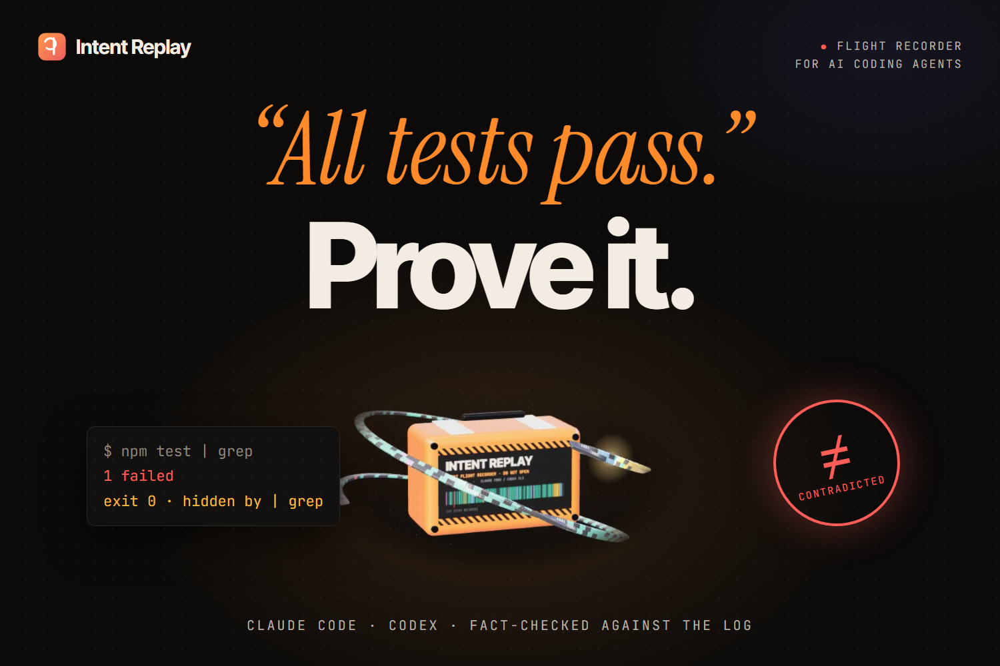

# Intent Replay

**Your coding agent says "all tests pass." Intent Replay checks that against what actually ran.**

When Claude Code or Codex finishes a task, you get a diff and a confident summary: *"Fixed the bug, all tests pass."* Intent Replay reads the agent's own session log and fact-checks every claim in that summary against the commands that really ran: the last test run failed, the exit code was hidden by `| tail`, only one filtered test was re-run, or a test file was edited to match. Each verdict links to the step that proves it. Around that check sits the rest of the story: every read, edit and command as a replayable timeline, and blame that tells you why each changed line was written.

**Try it in the browser:** https://dakshhhhh-ops.github.io/intent/ (the main button opens a real Claude Code session; your own logs never leave your machine)

**Watch the 2-minute demo:** https://www.youtube.com/watch?v=UKzPYKwQJnM

[](https://www.youtube.com/watch?v=UKzPYKwQJnM)

The demo walks through a real Claude Code session where the agent said "all 6 tests pass" while its last test run printed `1 failed`: the Brief, the Replay at the step that proves it, blame on a changed line, the Findings, the Stop hook sending a false "done" back (on the scripted sample), a Claude Code vs. Codex comparison, and the measured numbers below.


## Measured on real sessions

On 24 October 2026, Intent Replay was run over every Claude Code and Codex session on the author's machine: 88 sessions (79 Claude Code, 9 Codex), from small fixes to multi-day builds. The totals grow a little on every rerun, because the session used to build this project is one of the 88 and is still being written; the contradiction counts have not moved.

- **43** sessions ended with checkable claims (*tests pass*, *build passes*, *fixed*, *CI is green*, *only changed X*, *didn't touch the tests*): 553 claims in all.
- In **6 of those 43 sessions (14%)**, the agent's own log contradicts at least one claim it made: **12 claims** in all. Typical cases: "123 tests pass" after the last full run had 2 failures and only one test file was re-run; "Tests: 133 pass" when the output, cut short by `| grep`, shows a failing assertion; "all 6 tests pass" next to `1 failed`. All 12 were reviewed by hand: 10 are clear contradictions and 2 are borderline (one command ran unit and browser tests together and the failure was in a unit test; one claim was hedged by the agent itself).
- **344** claims are Supported, **179** Unverified and **18** Stale. Unverified is not a failure: it means the log holds no proof either way, for example a check that only ran in a scratch copy, a piped test run whose summary was cut off, or "CI is green" with no look at CI.
- **34** sessions have at least one high-severity finding: failing checks hidden by a pipe, credentials that ended up in the agent's context, silenced errors, weakened tests and risky commands. Only 7 of them are flagged for a credential alone. Placeholder values (`your-key-here`, `xxxx`, AWS's example key, local dev database passwords) and fake keys in test or fixture files are still masked but never flagged, so a "consider rotating it" finding means the value looked like a real key.
- This is one developer's data, mostly hackathon builds and code reviews, so read 14% as one data point, not a rate for every agent. Codex is the thinner half: 9 sessions, none with a contradicted claim, and the checks were tuned mostly on Claude Code logs. Auditing those Codex logs did turn up a parser gap: Codex 0.162+ runs commands inside JavaScript `exec` cells, and those were being dropped, hiding test runs (one session went from 0 commands to 47). That is fixed, and the main false-claim cases now have Codex-format tests too. If you run the audit on your own sessions, its summary holds only counts and random keys: [open an issue](https://github.com/Dakshhhhh-ops/intent/issues) with it and it will be added here.
- The biggest session, 530 MB, opens in the browser. Parsing it takes about 2 seconds (down from 7.7) because API request dumps and base64 screenshots are dropped before decoding.

A green stamp has to be earned, so the Supported verdicts were reviewed too: three random samples of 30, each followed by fixes for whatever did not hold up. A passing check in a scratch copy no longer proves anything about the project; a claim about CI needs a CI run, read strictly and for the commit it names, and goes stale if new commits were pushed after the last look; a claim listing several fixes needs the full suite, not one narrow test; a test run counts only if its exit code is its own or its pass summary is still in the output; and "146 of 146 tests pass" backed by a run that printed `8 passed` is not proof. In the last sample, 27 of 30 Supported verdicts hold up; the other 3 rest on evidence that is related but weaker than the claim (for example a different workflow's CI run).

An outside review then ran the tool on a long chat-style session and found it reading headings, review tables and quoted UI text as claims, and counting a crashing `node -e` script as a test run. Headings, blockquotes, bold labels, long table rows and quoted text are no longer read as claims; "fixed" needs the agent to have edited something; inline scripts (`node -e`, `python -c`) are not checks; and phrasings it used to miss ("No tests fail", "0 failing", "Tests: ✅", "Nothing is broken") are now caught. All of these cases live in a regression set ([`tests/claims-regression.test.ts`](tests/claims-regression.test.ts)) that runs in CI and reports precision and recall, so accuracy can't quietly slip back. The set was written from hand-reviewed cases after the fixes, so it guards against regressions; it is not an independent benchmark.

Contradictions got the same treatment earlier: ESLint's `✖ 198 problems (0 errors, 198 warnings)` had been read as a failure, wrongly turning 28 true "all checks pass" claims into contradictions, and a failing test in a command that also ran `mypy` no longer counts against "mypy is clean". Noise came down too: findings went from 3,161 to 669 in the first round, and a check piped through `| tail` with nothing wrong in its output is now one note per run instead of one alarm per command.

Run the same audit on your own machine. It prints counts and stable session keys (no titles or prompts, so the output is safe to share), caches results, and nothing leaves your computer:

```bash
npx -y github:Dakshhhhh-ops/intent audit
```

## What it does

- **Fact-checks the agent's claims.** "All tests pass", "build succeeds", "only changed `cart.js`", "didn't touch the tests". Each claim in the agent's closing message is stamped **Supported**, **Contradicted**, **Stale** or **Unverified**, with a link to the step that proves it. It sees through `npm test | tail` (exit code hidden), re-running only one filtered test, and tests that passed before the code changed again.
- **Stops a false "done" before you see it.** Installed as a Claude Code Stop hook, it checks the agent's final message the moment it tries to finish. A contradicted claim sends the agent back with the evidence: *"You said 'All 6 tests pass', but the last test run printed '1 failed'. Fix it or correct your summary."*
- **Blame, but for intent.** Click any changed line to see the step that wrote it, the reason the agent gave just before, whether it had even read that file, and what had just failed.
- **Replays the run.** A timeline ("the tape") of every read, edit and command, with chapters (Explore, Change, Verify, Repair, Report). Scrub it, step through it with the keyboard, or press play and watch files light up in the file map.
- **Flags what a reviewer should look at.** Deterministic rules, no AI: weakened tests, blind edits, failure loops, silenced errors, risky commands, leaked secrets, new dependencies, churn, sensitive files, unverified finishes, masked exit codes.
- **Follows a run live.** `intent-replay watch` opens the session an agent is writing right now; the tape grows as it works and claims are checked the moment they're made.
- **Compares agents.** Put two runs of the same task side by side: how much each explored before editing, what it changed, whether it verified the final change, and whether its claims held up.
- **Fits your workflow.** A CLI that finds your local sessions, prints a PR-ready Markdown report, fails CI on high-severity findings, and exports a single offline HTML replay you can send to a reviewer.

| Replay | Blame with "why" |
|---|---|
|  |  |
| **Findings** | **Compare two agents** |
|  |  |

## Who it's for

Developers who let an agent work on their repo and then have to decide whether to merge, and the teammates who review those PRs without ever seeing the run.

## Use it

### In the browser

Open the [hosted app](https://dakshhhhh-ops.github.io/intent/) and drop a session log on it. Everything runs locally in the page.

| Agent | Where the logs are |
|---|---|
| Claude Code | `~/.claude/projects/<project>/<session>.jsonl` |
| Codex CLI | `~/.codex/sessions/YYYY/MM/DD/rollout-*.jsonl` |

On Windows, `~` is `C:\Users\<you>`.

### From the command line

```bash
npm i -g github:Dakshhhhh-ops/intent    # builds on install, needs Node 20+

intent-replay                     # list sessions for this folder and open the picker
intent-replay open latest         # replay the newest session
intent-replay watch               # follow the newest session live while the agent works
intent-replay report latest       # PR-ready Markdown (--out report.md, --json)
intent-replay check latest        # exit 1 on high findings (--fail-on medium|low)
intent-replay export latest -o replay.html   # one offline file, secrets masked
intent-replay audit               # fact-check every local session at once (counts and keys only, --json)
intent-replay hook install        # check claims every time Claude Code stops (see below)
```

A target is a key from `intent-replay list`, a number, `latest`, or a path to a `.jsonl` / `.json` file.

### Catch a false claim before the agent finishes (Claude Code)

```bash
npm i -g github:Dakshhhhh-ops/intent
intent-replay hook install        # --project writes this repo's .claude/settings.json instead
```

This adds a [Stop hook](https://code.claude.com/docs/en/hooks) to `~/.claude/settings.json`, next to any hooks you already have:

```json
{
  "hooks": {
    "Stop": [
      { "hooks": [{ "type": "command", "command": "node \"/path/to/intent/dist-cli/intent-replay.mjs\" hook", "timeout": 60 }] }
    ]
  }
}
```

When Claude Code tries to finish, the hook reads the session log so far plus the final message (`last_assistant_message`, because the log file can lag behind), and checks only the claims in that message. If one is contradicted, the hook exits with code 2 and Claude Code gives the agent the reason instead of stopping:

```
Intent Replay checked your final message against this session's log and found a claim it contradicts:
- You said "All 6 tests pass.", but your own log disagrees: The last test run (step 3) failed. Its exit code
  was hidden, but the output reports failures. "Tests: 1 failed, 5 passed, 6 total"
Fix the problem and rerun the check, or correct your summary so it says what the log shows.
```

It sends the agent back once. If the next final message is still contradicted (`stop_hook_active` is set), you get a warning instead of a loop. Supported, Unverified and Stale claims never block, and if the hook itself fails, the agent stops normally. The hook is for Claude Code; for Codex runs, use `intent-replay check latest` afterwards.

### On a pull request

The agent's session log lives on the machine that ran the agent, so the usual path is to write the report there and paste it into the PR:

```bash
intent-replay report latest --out intent-report.md
```

If the agent itself runs in CI, its log is on the runner when that step ends, and the check can follow it in the same job. Claude Code keeps the session log for `claude -p` runs, and `latest` picks the newest session for the current folder:

```yaml
- run: claude -p "$TASK"
  env:
    ANTHROPIC_API_KEY: ${{ secrets.ANTHROPIC_API_KEY }}
- run: npx -y github:Dakshhhhh-ops/intent report latest --out intent-report.md
- run: npx -y github:Dakshhhhh-ops/intent check latest --fail-on high
```

### From source

```bash
git clone https://github.com/Dakshhhhh-ops/intent && cd intent
npm install          # also builds dist/ and dist-cli/
npm run dev          # viewer with hot reload
npm run typecheck    # TypeScript, no emit
npm test             # 420 unit tests: parsers, blame, claims, rules, redaction, hook, server, large logs
npm run e2e          # 8 Playwright tests of the core journey in a real browser
npm run build        # dist/ (viewer), dist-export/ (offline replay page), dist-cli/ (CLI)
```

## How it works

```
session log ──► parser ──► one timeline of steps ──► analyzer ──► Brief · Replay · Changes · Findings
 (Claude Code,    (src/core/parse)                    (src/core/analyze)        (browser, CLI, CI, HTML export)
  Codex, Intent
  Trace JSON)
```

1. **Parse.** Each agent's log becomes the same list of steps: prompts, agent messages, reads, searches, edits, commands with exit codes and output, plans. Claude Code records full old/new strings and file snapshots; Codex records commands and unified diffs; both are handled, including Codex sessions that span two CLI versions.
2. **Rebuild files.** Every changed file is replayed edit by edit, and each line remembers the step that wrote it. When the log lacks enough to place an edit exactly, the file falls back to per-edit attribution and says so.
3. **Analyze.** Steps are grouped into chapters, every rule runs, and claims from each turn's closing message are checked against the commands that ran before them.
4. **Show.** The same core runs in the browser and in the CLI, so the web view, the Markdown report and the CI check always agree.

Secrets are masked as soon as a log is read, in the UI, in every export and before the local server sends a log to the browser: provider keys (OpenAI, Anthropic, AWS, GitHub, GitLab, npm, Hugging Face, Slack, Stripe, SendGrid, Google, Discord), JWTs, private keys, `Bearer` tokens, passwords in URLs (`postgres://user:pass@…`) and on command lines (`curl -u user:pass`, `wget --password=…`, `mysql -pSECRET`), Slack and Discord webhook URLs, Azure connection strings, AWS-style `aws_secret_access_key = …` lines, `NAME_KEY=` / `_TOKEN=` / `_SECRET=` assignments, and `password` / `token` / `api_key` values in JSON, YAML and config files. Masking is pattern-based, so review an export before sharing it outside your team.

The local viewer (`intent-replay`) listens on 127.0.0.1 only, answers only requests addressed to `127.0.0.1` or `localhost` (which blocks DNS-rebinding attacks from other websites), and requires a random per-run token that is part of the link it opens.

## Under the hood

**One core, three front ends.** `src/core/` (about 5,000 lines of TypeScript) uses no DOM and no Node APIs. The browser viewer, the CLI and the CI check all import it, so a verdict in the web view is the same verdict in the Markdown report and the exit code of `check`.

**Parsing** ([`src/core/parse/`](src/core/parse))
- `detect.ts` sniffs the format and routes to `claudeCode.ts`, `codex.ts` (both rollout formats, including the JavaScript `exec` cells of Codex 0.162+) or `intentTrace.ts`.
- `slim.ts` drops dead weight line by line before `JSON.parse`: Claude Code API request dumps, file-history snapshots and base64 images over 2 KB. On a 530 MB session that is over 85% of the bytes, which keeps the log under V8's ~512 MB string limit and cuts parsing from 7.7 s to about 2 s.
- In the browser, a Web Worker ([`src/ui/parseWorker.ts`](src/ui/parseWorker.ts)) streams and parses the dropped file and reports progress, so a large session never freezes the page.

**Blame** ([`analyze/files.ts`](src/core/analyze/files.ts)). Each touched file is seeded from full reads and Claude Code's `originalFile` snapshots, then every edit is replayed on top (line diffs with the `diff` library). Each line keeps the step that wrote it, which is what Changes shows next to the agent's reason, the files it had read and the last failure before it. Edits that can't be placed exactly fall back to per-hunk attribution and the file is marked partial.

**Commands** ([`analyze/commands.ts`](src/core/analyze/commands.ts)). Shell commands are classified (test, typecheck, build, lint, install, git, run, read, search) across common runners: vitest, jest, mocha, pytest, go test, cargo, dotnet, Maven, Gradle, Playwright, Cypress and others. One command can be several kinds (`npm run build && npm test`). The same module knows when a pipe (`| tail`, `| grep`, `| head`) hides a failing exit code, when a run is filtered to a few tests, when it ran in a scratch copy, and how to read pass/fail summaries out of the output.

**Claims** ([`analyze/claims.ts`](src/core/analyze/claims.ts)). Claims are found with patterns, not a model, so every verdict is reproducible: tests pass, build passes, typecheck/lint clean, CI green, fixed, only changed X, didn't touch the tests. Each is checked against the commands that ran before it and after the last edit, and stamped Supported, Contradicted, Stale or Unverified with links to the evidence steps.

**Rules** ([`analyze/rules.ts`](src/core/analyze/rules.ts)). Deterministic checks for weakened tests, blind edits, failure loops, silenced errors, risky commands, secret exposure, new dependencies, churn, sensitive files, unverified finishes and masked exit codes, each with a severity and the steps it points at. Chapters (Ask, Explore, Change, Verify, Repair, Report) come from [`analyze/phases.ts`](src/core/analyze/phases.ts).

**Viewer** ([`src/ui/`](src/ui)). React 19 and Vite, built into a single self-contained HTML file with `vite-plugin-singlefile`, so the CLI can serve it and GitHub Pages can host it. A second build (`vite build --mode export`) swaps the home page and the bundled samples for stubs and becomes the template for `intent-replay export`: one offline HTML file with the trace embedded. The home page uses Three.js for the 3D flight recorder and GSAP and Lenis for scroll motion.

**CLI** ([`cli/`](cli)). Bundled with esbuild into one Node file. `sessions.ts` finds logs in `~/.claude/projects` and `~/.codex/sessions`; `server.ts` serves the viewer locally (see the security notes above); `hook.ts` is the Claude Code Stop hook, which reads the hook input on stdin, checks only the claims in `last_assistant_message`, and exits 2 with the evidence when one is contradicted.

**Tests and CI.** 420 Vitest unit tests in 13 files cover the parsers, blame, command classification, claims, rules, redaction, the Markdown report, the hook and the local server. [`tests/claims-regression.test.ts`](tests/claims-regression.test.ts) holds hand-reviewed claim cases and reports precision and recall. 8 Playwright tests drive the built viewer through the core journey. [GitHub Actions](.github/workflows/ci.yml) runs typecheck, unit tests, the build, a CLI smoke test (the scripted sample must report Contradicted and fail `check`; the clean run must pass) and the Playwright suite, then publishes the viewer to GitHub Pages on every green push to `main`.

**Stack.** TypeScript, React, Vite, Node.js, esbuild, Three.js, GSAP, Lenis, `diff`, Vitest, Playwright, GitHub Actions, GitHub Pages.

## Formats

- Claude Code session JSONL
- Codex CLI rollout JSONL (older `response_item` and newer `item_completed` formats)
- **Intent Trace JSON**, the format the tool uses internally (the bundled samples and every exported trace use it), documented so other agents or converters can target it: [docs/TRACE_FORMAT.md](docs/TRACE_FORMAT.md). No agent writes it natively today.

## Sample runs

| Sample | What it shows |
|---|---|
| [`examples/taskforge-handrail.intent.json`](examples/taskforge-handrail.intent.json) | **Real session.** An unscripted Claude Code session from building Handrail, an accessible project board. The agent reports "all 6 tests pass" after testing in a separate copy; its last browser test run printed `1 failed`, and a `| grep` at the end of the command hid that from the exit code. Trimmed with `--steps` to the part of the session where it happens. Machine paths are rewritten, and lines about a separate hackathon submission draft are removed with `--drop-files` and `--redact-lines`, each marked `[line removed]`; nothing else is changed. |
| [`examples/csv-quotes-claude.intent.json`](examples/csv-quotes-claude.intent.json) | **Recorded run.** A real headless Claude Code session fixing quoted CSV fields. Clean. |
| [`examples/csv-quotes-codex.intent.json`](examples/csv-quotes-codex.intent.json) | **Recorded run.** The same task given to Codex CLI. Clean. |
| [`examples/cart-rounding.claude.jsonl`](examples/cart-rounding.claude.jsonl) | **Scripted scenario.** Fixing an off-by-a-cent cart total, the agent breaks discounts with a blind edit, rewrites a test to match, runs only that one test, and reports "All tests pass." The agent's decisions are scripted; every file and every test result in the log is real (generated by [`scripts/make-scripted-sample.mjs`](scripts/make-scripted-sample.mjs)). |

The two CSV runs are clean, so they show what a passing check looks like. The Handrail session is one of the 12 real contradictions from [Measured on real sessions](#measured-on-real-sessions); run `intent-replay audit` to find them in your own logs.

Recorded runs were imported with [`scripts/import-run.ts`](scripts/import-run.ts), which rewrites machine paths and refuses to write a file that still contains personal data.

## Project layout

```
src/core/      parsers, analyzer, rules, claims, redaction, Markdown report (no DOM, no Node APIs)
src/ui/        React viewer
cli/           intent-replay command (session discovery, local server, report/check/export)
examples/      sample runs (also bundled into the viewer)
tests/         unit tests, claim regression set, Playwright browser tests (tests/e2e)
scripts/       sample generation, run import, screenshots, Pages deploy
docs/          trace format, screenshots, demo video cover
devpost/       planning documents: scope, PRD, spec, build checklist
```

## What's next

- Publish to npm (today it installs from GitHub: `npm i -g github:Dakshhhhh-ops/intent`).
- More Codex coverage: only 9 Codex sessions were in the audit, and the checks were tuned mostly on Claude Code logs.
- A Codex counterpart to the Stop hook; for now, Codex runs are checked afterwards with `intent-replay check latest`.
- More data: the 14% above comes from one developer. Audit summaries from other machines (counts and random keys only) are welcome as [issues](https://github.com/Dakshhhhh-ops/intent/issues).

## Built for Build With AI: Basics

Demo video: https://www.youtube.com/watch?v=UKzPYKwQJnM


This project was planned and built with the Devpost Learn skill pack during the hackathon. The planning documents are in [`devpost/`](devpost): [scope](devpost/scope.md), [PRD](devpost/prd.md), [spec](devpost/spec.md) and the [build checklist](devpost/checklist.md). The [app map](devpost/app-map.html) is a one-page guide to the finished code: one action traced through three code stops, where to make common changes, and how to run it (download it and open it in a browser, or read it on [htmlpreview](https://htmlpreview.github.io/?https://github.com/Dakshhhhh-ops/intent/blob/main/devpost/app-map.html)).

## License

[MIT](LICENSE)
